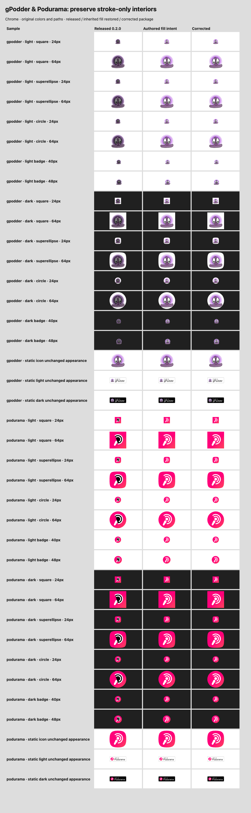
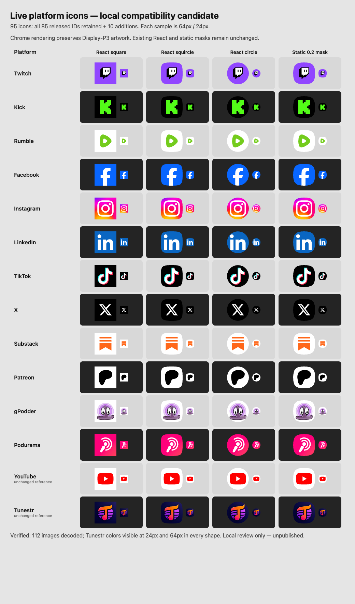

# Local live-platform candidate: compatibility investigation

This patch is additive to the published package. It is based on `main` at
`5e87a7e`, whose tree matches `v0.2.0`, and lives on the isolated local branch
`codex/live-platform-icons-compatible`. It supersedes the earlier candidate
based on `refraction`; that candidate and its artifacts are preserved for
comparison and must not be used for the consumer update.

## Finding and exact missing IDs

The public npm 0.2.0 tarball and Podlink's installed package both expose **85**
icon IDs. Their ESM and CJS core/React files are byte-identical. The IDs also
exactly match Podlink's `src/lib/platform-icons.ts` helper. Building unmodified
`main` reproduces all published icon data, metadata, and 255 static icon/badge
files without differences.

The previous refraction-based candidate exposed 94 IDs but omitted these 23
published/consumed IDs:

```text
apollo breaker breez bullhorn deepcast fathom google instacast itunes jam
lnbeats luminary mixerbox podhero podknife podvine podyssey radiopublic resso
samsungfree stenofm stitcher wondery
```

This was a **wrong-base issue**, not a generated-export omission. Refraction's
platform source directories and metadata had already removed those entries:

- `fb603c5` explicitly retired eleven: apollo, bullhorn, deepcast, fathom,
  instacast, jam, podhero, podknife, podvine, resso, samsungfree.
- `69091eb` explicitly removed inactive platforms; eleven remain absent:
  breaker, breez, google, itunes, lnbeats, luminary, mixerbox, podyssey,
  radiopublic, stitcher, wondery. Sonnet was also removed there but later restored.
- `572dc03` deleted Steno.fm during its broader artwork/platform refresh.

Those are intentional catalog changes on the separate branch, but they are
breaking removals for this consumer and were not part of the requested addition.
The earlier candidate also included 24 unrelated new platforms and different
icon-data objects for all 62 retained original IDs. Restoring only the 23 names
would therefore still silently ship unrelated refraction changes.

## Fix and scope

Use the released architecture on `main`: add artwork under
`src/source-icons/<id>/icon.svg` and append entries to `src/data/platforms.json`.
All 85 metadata records and ordering, aliases, runtime components, types,
shapes, build scripts, optimizer settings and lockfile are unchanged. Existing
source changes are limited to the authorized gPodder and Podurama stroke-fill
corrections described below; the other 83 platforms are byte-identical. The ten new IDs are:

```text
twitch kick rumble facebook instagram linkedin tiktok x substack patreon
```

The final candidate has **95 IDs**, with no removed old IDs and no unrelated new
ones. `twitter` is a new alias for `x`. There is no generic `watchlive` icon or
destination. The source manifest remains at 0.2.0; no release bump is performed in this patch.

The bounded Podlink inventory contained 48 platform SVGs. Seven requested
social/live marks were already present there: Twitch, Rumble, Facebook,
Instagram, LinkedIn, TikTok, and X. Kick, Substack, and Patreon were absent from
both the inspected repositories and the released package. The eight platforms
already marked `canListenLive: true` in Podlink's seed—Podcast Addict, Podverse,
Fountain, Podcast Guru, Castamatic, CurioCaster, TrueFans, Tunestr—already had
package artwork; they are preserved, not newly added. YouTube is also preserved.

## Artwork provenance and layout

All source SVGs have `viewBox="0 0 32 32"`. The first seven come from
`TeamPodlink/podlink-v3/public/images/platforms/<id>.svg` at commit
`bd447f04ee80d8c6542bd2534488362b49ce4882`. Original paths/colors are unchanged;
only Rumble adds a white plate behind its transparent green mark. Facebook's
intentional bottom bleed remains. A final newline is added to copied files.

| ID | Official source / placement for assets absent locally |
| --- | --- |
| `kick` | First K glyph from [the official wordmark](https://static.kick.com/kick-logo.svg), linked by [KICK's brand page](https://about.kick.com/brand). Exact path and green `#53FC18`; translate (7.44, 6), uniform scale 0.8333333333, black plate. |
| `substack` | Exact three orange logo paths embedded as `nav-logo-icon` on [Substack's brand page](https://substack.com/brand). Original `#ff6719`; translate (7.25, 6), uniform scale 0.8333333333, white plate with whitespace. |
| `patreon` | Exact symbol path embedded as `logomark` on [Patreon's brand page](https://www.patreon.com/brand). Inherited `currentColor` resolved to its official black treatment; translate (5.55, 4.45), uniform scale 0.55, white plate with whitespace. |

Official sources were retrieved 2026-10-24. The marks are not redrawn,
nonuniformly scaled, or cropped. Original source SHA-256 hashes:

```text
twitch    af9085b73dd0901283d1a3ea49ab997995770d269eee2f024f4424a64dd50b59
rumble    552b724d0365370ac043620ea9c385f90e62cf36d408be5bfdc8eeecb83785f9
facebook  53a78f8bdcef76db59607e3ea435ed0d89f9a935bd4920beb723dccd582236ed
instagram fe53bd23a94919ad018f0b4da33533c35ee504da9f484b219cf261f575bc7e69
linkedin  90156d75e6761699f2e7f0a8ae954b424a0e4bac4d4d03a64373b838a472fbbc
tiktok    9e352a173f416e6115ed42d66d318fc90abd90642c2088caa3adddccc97106ee
x         cf685e4f4f2dc66222ced6881c6eb885f28e7aeea989b5596f3e81ff179dd5fa
kick      a5e80b05c77fb7355024f7790690d13f26277eb6d959de417deb94dc5d53a33a
substack  cb20248b7d3bbb1f9e852571383119c5fe2f341948b26024305c19c6c57db3cd
patreon   ed13ce1027732345e5d5433c5d67605893cb12e9b5a9c9f3ea906014548cfa1e
```

Substack/Patreon hashes refer to the original inline SVG plus a final newline;
Kick's hash refers to the complete source wordmark. Original downloaded sources
are retained among local review artifacts.

The packaged `NOTICE.md` distinguishes MIT code from platform-owned artwork.
Substack's guidelines do not themselves grant trademark permission and allow
accurate reference where permitted by law. Patreon permits digital identification
of a creator's Patreon presence and prohibits sublicensing its marks. No new
brand-owner permission or sublicense is asserted. There is no asset-download or
local implementation blocker; public release/distribution approval remains
separate. Original acquisition records for the seven existing Podlink SVGs are
not present beside those sources.

## Shape compatibility

Published 0.2.0 uses the house squircle for React and a different legacy mask for
static SVGs. This pre-existing difference is retained, not silently corrected.
Every existing shape retains its geometry. The other 83 platforms retain exact
React/static output; gPodder and Podurama restore intended stroke transparency
in React while retaining the existing static appearance. New React icons use the same house squircle as all
existing React icons; new static icons follow the same static convention as the
published package. Refraction's shape-variant feature and changed clipping are
not included. Any future static-mask unification needs its own reviewed change.

## Consumer API and local artifact

The public API is unchanged; there are no per-platform named component exports:

```tsx
import { PlatformIcon } from '@podlink/icons/react'

<PlatformIcon platform="twitch" shape="superellipse" size={24} decorative />
<PlatformIcon platform="kick" shape="superellipse" size={24} decorative />
<PlatformIcon platform="rumble" shape="superellipse" size={24} decorative />
<PlatformIcon platform="facebook" shape="superellipse" size={24} decorative />
<PlatformIcon platform="instagram" shape="superellipse" size={24} decorative />
<PlatformIcon platform="linkedin" shape="superellipse" size={24} decorative />
<PlatformIcon platform="tiktok" shape="superellipse" size={24} decorative />
<PlatformIcon platform="x" shape="superellipse" size={24} decorative />
<PlatformIcon platform="substack" shape="superellipse" size={24} decorative />
<PlatformIcon platform="patreon" shape="superellipse" size={24} decorative />
```

Core consumers import `getIconData`, `getPlatform`, `hasPlatformIcon`, and type
`PlatformId` from `@podlink/icons`. Static exports are
`@podlink/icons/static/icons/<id>.svg` and
`@podlink/icons/static/badges/<id>-light.svg` / `<id>-dark.svg`.
This compatible base does **not** add static `<id>-square.svg` or
`<id>-circle.svg` variants; request those shapes through React's existing prop.

The final review archive is explicitly **local-only**, version
`0.2.1-local.live-platforms.3`, with `private: true` in its staged manifest to
block accidental publication. It is not npm's released 0.2.0, and it is not a
proposed public version. The staging operation changes no source manifest
version. Earlier refraction and eight-addition compatibility archives remain
untouched for comparison.

Install the absolute archive path only in the coordinating consumer's isolated
worktree. Regenerate Podlink's `src/lib/platform-icons.ts` ID set/aliases using
its documented command: the expected diff is the ten additions and `twitter`
alias, with no old IDs removed. The consumer task owns app routing and helper
changes. Do not commit a local tarball dependency path as the eventual release
dependency.

## Verification

`src/core/__fixtures__/published-0.2.0.json` was captured from the actual public
npm tarball, whose SHA-256 is
`c17c4564c1d742707817c6da99412866020e1e66e43f3f4603c8cd0a57a7f19b`.
It is independent of the candidate source and must not be refreshed merely to
make a regression pass. It records Podlink's 85 current IDs, export names,
metadata/artwork hashes, shape paths, rendered-output hashes, and static hashes.

Run the existing package commands, building before the compatibility test:

```sh
pnpm install --frozen-lockfile
pnpm validate
pnpm build
pnpm test
pnpm lint
pnpm exec tsc --noEmit
```

The compatibility suite checks all 85 released IDs, metadata and aliases, all
three shapes at five icon sizes, both badge themes at two sizes, and the exact
bytes of 249 unchanged static files. Six gPodder/Podurama static files have explicit
fill attributes but identical browser pixels; their approved bytes and React
outputs have a separate narrowly scoped fixture. A separate packed-artifact smoke test
checks ESM/CJS imports, both declaration formats, and 2,295 existing React
render variants per module format against the same release fixture.

Final checks passed: 315 tests in six files (270 compatibility/addition/correction checks),
full package build, source validation with zero errors/warnings, full ESLint,
TypeScript, and the extracted local-only archive's ESM/CJS/static/type checks.
The frozen dependency install used pnpm 10.15.0 and Node 26.7.0; no dependency
or lockfile changes were made.

## Tunestr contact-sheet correction

The exact original Library image (`libfile_220765c752cc81918fc4a3ae44521114`)
showed Tunestr nearly black. Its package source contains 19 CSS Display-P3
gradient color declarations. The source SVG is identical on main and refraction;
its viewBox is `0 0 32 32`, all paint/filter/mask references resolve, and the
published and compatible generated static SVGs are byte-identical. Podlink's
older asset uses the same mark with sRGB hex colors and an embedded legacy mask.

The defect was the review renderer, not malformed or missing brand artwork:
Sharp 0.34.5 / librsvg 2.61.2 returned `[0,0,0,255]` for a red
`color(display-p3 1 0 0)` probe, while an sRGB `#ff0000` probe returned
`[255,0,0,255]`. In isolated Chrome, the exact unchanged Tunestr source and both
package outputs display their colored mark at 24px and 64px. No logo, path,
viewBox, mask, or package export was changed to compensate for a screenshot bug.

`scripts/review-live-icons.mjs` fixes the review pipeline by using installed
Chrome with an isolated temporary profile and an sRGB screenshot output profile.
It adds no dependency. Run after `pnpm build`:

```sh
node scripts/review-live-icons.mjs /tmp/podlink-live-icon-review
```

Set `CHROME_BIN` if Chrome is not at a known macOS/Linux path. The script rejects
a renderer that fails the P3-red pixel check, requires all 112 images to decode,
and checks that Tunestr has visible colored pixels for all three React shapes
and static output at both sizes. Verified colored coverage ranges from 38.6%
to 50.2%; the original black rendering would fail the 10% threshold. The PNG,
self-contained HTML, and `visual-checks.json` provide regression evidence.
Original incorrect images remain outside the patch for comparison; the corrected
contact sheet replaces the existing Library image rather than creating another
identity (version 2); the latest sheet also includes gPodder and Podurama. Tunestr
remains covered by the unmodified published compatibility
fixture, with no exception or weakened assertion.

## gPodder and Podurama: confirmed fill defects

Chrome showed that the repository source SVGs and the older Podlink source
artwork have the intended bright gPodder face and open Podurama arcs. Published
React output instead darkens gPodder and fills Podurama's arcs black. The source
root's `fill="none"` is lost when codegen extracts its inner content. Unlike
Tunestr's screenshot problem, this defect occurs in a P3-capable browser.

Only four SVGs change: `src/source-icons/{gpodder,podurama}/{icon,badge}.svg`.
Move the inherited `fill="none"` from the root onto the six gPodder and two
Podurama stroke-only paths. Colors, path data, gradients, filters, viewBoxes,
transforms and masks remain unchanged. SVGO can now retain the intended fill
inside generated content without a global generator/runtime change. SVGO also
omits redundant explicit black fills under the restored default black root;
they still render black. The existing static build already preserved root fill,
so its six corrected SVGs have byte changes but identical pixels.

The original published fixture stays untouched. A separate
`stroke-fill-corrections.json` pins only these two approved output changes;
metadata/aliases still use the original baseline, all 83 other platforms retain
all original hashes, and targeted assertions require exactly six/two transparent
stroke paths in both icon and badge content.

```sh
node scripts/review-stroke-fills.mjs /path/to/extracted/npm-0.2.0/package /tmp/stroke-review
```

The extracted baseline needs the same installed React peer modules accessible.
The browser test compares released output, its authored inherited-fill intent,
and the corrected output: 38 samples across three shapes, 24/64px, light/dark
backgrounds, badge glyphs at 40/48px badge heights, and all six static files.
All corrected pixels match the intended fill (one-channel antialias tolerance),
all 32 affected React samples reproduce a visible old defect, and all six static
samples remain identical. This changes no brand geometry or P3 color values.





## Release boundary

The source package remains 0.2.0. A future **0.3.0 minor release** is proposed for these
additive icons and artwork fixes ;
versioning and release approval are separate from this PR. The repository has
no automatic npm publication workflow: normal publication is a maintainer's
explicit `npm publish --access public` (which runs `prepublishOnly`) to the npm
registry. No publication command, release tag, or credentials are changed here.
After approved review/merge and release, update Podlink to that published version
and regenerate its platform helper; do not retain the local tarball path.

The PR targets compatible `main`, not `refraction`. Main PR workflows run CI and
an SVG preview branch/comment; they do not deploy the site. Merging into main
would separately trigger its existing Pages deployment. Refraction's separate
Cloudflare site deployment is push-triggered and could deploy on merging a PR
there before any npm publication; it is not part of this patch. PR7 remains
untouched. Only this feature branch/PR publication is authorized, not merge or
package release.
